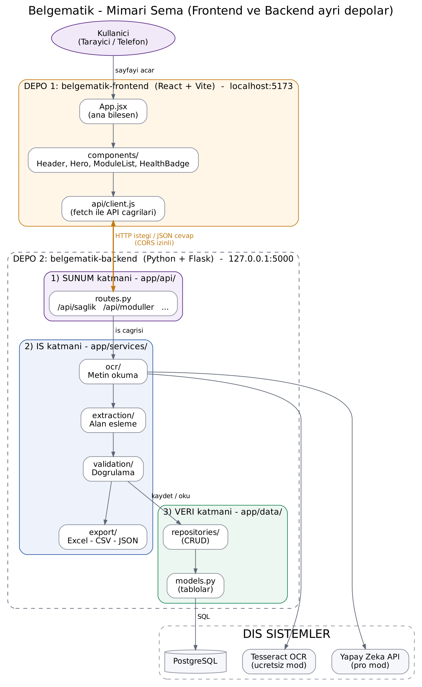

# Belgematik – Frontend (React)

**Fiş, fatura ve kartvizit fotoğraflarından yapılandırılmış veri çıkaran uygulamanın kullanıcı arayüzü.**

> Proje iki ayrı depodan oluşur:
> - **belgematik-frontend** (bu depo): React + Vite arayüzü
> - **[belgematik-backend](https://github.com/hasankamiloglu/belgematik-backend)**: Python + Flask API
>
> Frontend, verileri backend'den **HTTP istekleriyle (JSON)** alır.
> Durum: **v0.2 – Proje iskeleti (Hafta 3)**

## Teknolojiler

React 19 · Vite · JavaScript (JSX) · CSS · fetch API

## Mimari



```
src/
├── main.jsx            # Uygulamanın başlangıç noktası
├── App.jsx             # Ana bileşen (sayfayı oluşturan parçaları birleştirir)
├── styles.css          # Ortak stiller
├── api/
│   └── client.js       # Backend ile konuşan TEK dosya (fetch)
└── components/         # Ekran parçaları (bileşenler)
    ├── Header.jsx      # Üst menü
    ├── HealthBadge.jsx # Backend bağlantı durumu rozeti
    ├── Hero.jsx        # Tanıtım bölümü
    └── ModuleList.jsx  # Backend'den gelen modül listesi
```

Bileşenler backend'e doğrudan istek atmaz; `api/client.js` içindeki fonksiyonları kullanır.
Böylece backend adresi değişirse tek bir dosya değişir.

## Kurulum (Windows)

Gerekenler: **Node.js (LTS)** ve çalışan **belgematik-backend**.

```powershell
git clone https://github.com/hasankamiloglu/belgematik-frontend.git
cd belgematik-frontend
npm install
copy .env.example .env
npm run dev
```

Tarayıcıda aç: http://localhost:5173

Sağ üstte **"API bağlı"** yazıyorsa frontend backend'e ulaşabiliyor demektir.
**"API'ye ulaşılamadı"** yazıyorsa önce backend'i başlatın (`python run.py`).

## Komutlar

| Komut | Ne yapar? |
|---|---|
| `npm install` | `package.json`'daki kütüphaneleri `node_modules` klasörüne kurar |
| `npm run dev` | Geliştirme sunucusunu başlatır (kod değişince sayfa anında yenilenir) |
| `npm run build` | Canlıya alınacak, küçültülmüş sürümü `dist/` klasörüne üretir |

## Lisans

Bu proje Bilgisayar Uygulamaları I dersi kapsamında geliştirilmektedir.
